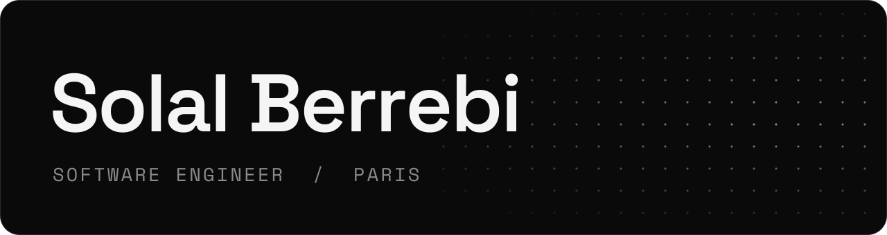
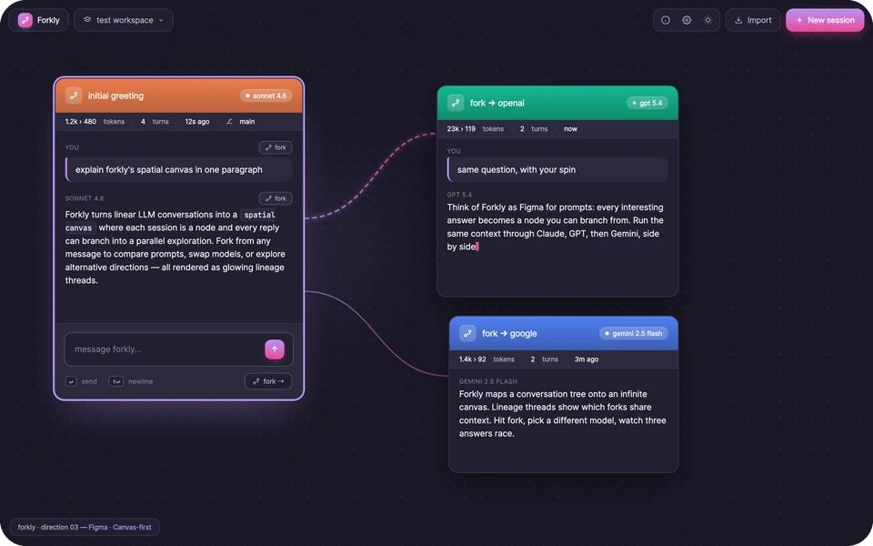
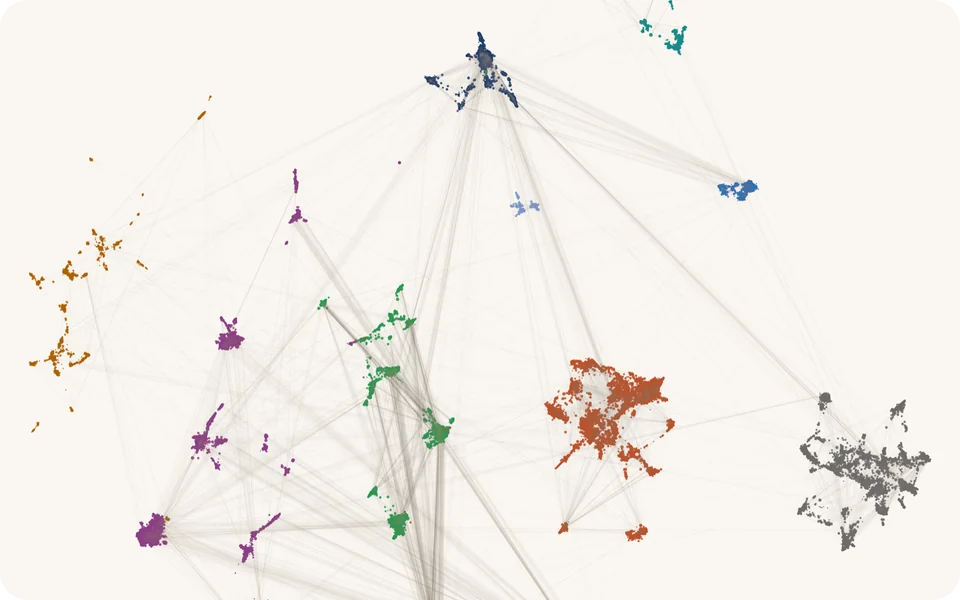
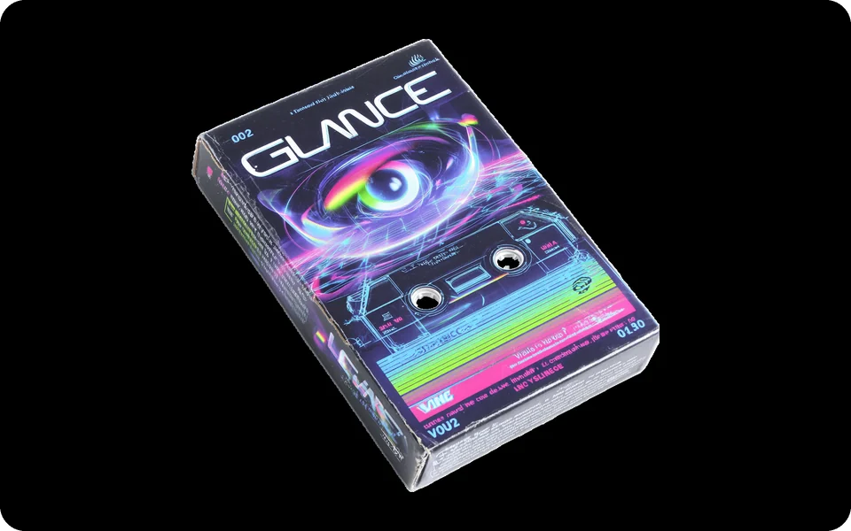

 

**I design and build products end to end — interface, backend, and the AI in between.**

Software engineer based in Paris. MSc in Computer Science & Machine Learning at Paris-Dauphine, previously on the Global Markets trading floor at Crédit Agricole CIB.

Everything below started as a personal frustration: something too slow, too clunky, or that simply didn't exist the way I needed it. So I built it.

[Portfolio](https://solalberrebi.com) &nbsp;·&nbsp; [Résumé](https://solalberrebi.github.io/Shared_docs/Solal_s_Resume_ny.pdf) &nbsp;·&nbsp; [LinkedIn](https://www.linkedin.com/in/SolalBerrebi) &nbsp;·&nbsp; [Email](mailto:pro@solalberrebi.com)

 

## Selected work

<table>
  <tr>
    <td width="50%" valign="top">
      
        
      <b><a href="https://apps.apple.com/us/app/vocafast-learn-vocabulary/id6760617266">Vocafast</a></b> — Learn vocabulary at the speed of thought.
       
      Snap a menu, paste an article, or just speak: AI extracts the vocabulary in 17 languages, then spaced repetition makes it stick. Native SwiftUI app and PWA on one backend.
       
      Swift · SwiftUI · Next.js · Supabase
        
      
    </td>
    <td width="50%" valign="top">
      
        
      <b><a href="https://github.com/SolalBerrebi/forkly">Forkly</a></b> — Figma for LLM conversations.
       
      An infinite canvas where any reply forks into parallel branches, the same prompt runs on Claude, GPT, Gemini and local models side by side, and the best answers merge. Open source, local-first.
       
      Rust · Tauri · React · TypeScript · SQLite
    </td>
  </tr>
  <tr>
    <td width="50%" valign="top">
      
        
      <b>Droit Fiscal France</b> — A RAG assistant over the French tax code.
       
      33,757 articles across 9 legal codes, linked by 41,837 citations into a navigable knowledge graph. Hybrid retrieval feeds Claude, which answers with its sources.
       
      Python · FastAPI · Claude · NetworkX · React
    </td>
    <td width="50%" valign="top">
      
        
      <b>ChabadEat</b> — Multi-tenant ordering for community restaurants.
       
      Each restaurant gets a branded storefront on its own subdomain, payments settled through Stripe Connect, and data isolated with Postgres row-level security.
       
      Next.js · TypeScript · Supabase · Stripe Connect
    </td>
  </tr>
  <tr>
    <td width="50%" valign="top">
      
        
      <b><a href="https://github.com/SolalBerrebi/Glance">Glance</a></b> — A teleprompter that follows your voice.
       
      Sits just below the MacBook camera and scrolls word by word as you speak, so you keep eye contact on any call or recording. Scripts stay on your machine.
       
      Electron · JavaScript · Whisper
    </td>
    <td width="50%" valign="top">
      
        
      <b><a href="https://github.com/SolalBerrebi/BloombergNewsletterSummarizer">Bloomberg Daily Brief</a></b> — The markets in five minutes.
       
      Reads the day's Bloomberg newsletters, summarises them with GPT-4 and explains the key concepts. Grew from a personal fix into a daily digest for 100+ finance students.
       
      Python · OpenAI · Telegram
    </td>
  </tr>
</table>

Full case studies on [solalberrebi.com](https://solalberrebi.com).

 

## Stack

Also: SwiftUI · Stripe · LLM APIs (Claude, GPT, Gemini) · RAG · agents · scikit-learn

 

<picture>
  <source media="(prefers-color-scheme: dark)" srcset="https://raw.githubusercontent.com/SolalBerrebi/SolalBerrebi/output/snake-dark.svg">
  
</picture>

 

## Get in touch

The fastest way to reach me is [pro@solalberrebi.com](mailto:pro@solalberrebi.com).
